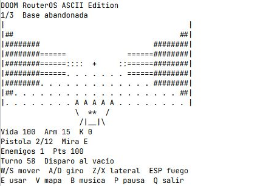

# MikroDOOM

Shooter en primera persona con música E1M1 para la consola de un MikroTik hEX RB750Gr3 con RouterOS 6.44.1. La campaña se ejecuta en el router. El PC solo necesita una terminal interactiva.



## Instalación desde cero

1. Clona este repositorio o descarga y descomprime el ZIP desde **Code → Download ZIP**. Antes de cargar nada, comprueba en **Files** si ya existe `doom-native`. Usa un directorio nuevo y vacío para esta instalación. Si ya corresponde a una instalación tuya, desinstálala primero.
2. En la raíz de **Files**, crea el directorio `doom-native` y sube allí los **seis** archivos `.rsc`. Puedes usar SFTP o WinBox. En el RB750Gr3 la carpeta de carga está fuera de `flash/`. Si desaparece tras un reinicio, basta con volver a subir el desinstalador para retirar los scripts persistentes.
3. En la terminal de RouterOS:

```routeros
/import file-name=doom-native/install.rsc
/system script run doom-mikrotik
```

El instalador comprueba versión, archivos y nombres. El mensaje de éxito es **DOOM instalado**. Los siete scripts registrados llevan el comentario `doom-native/1.1/6.44.1`. Son el punto de entrada, el motor de turnos, los enemigos, el renderizador, los niveles, el audio y las pruebas. Solo el instalador y el desinstalador cambian ese repositorio de scripts. El juego carga las funciones en variables locales con `:parse` y mantiene el estado de una sola partida en memoria.

## Primera partida

Tras instalar los scripts, abre **New Terminal** en WinBox o una sesión SSH interactiva con tu router. Ejecuta el juego en primer plano.

```routeros
/system script run doom-mikrotik
```

1. La partida empieza en primera persona, con ANSI, efectos y E1M1 activados. **B** silencia la música y **M** silencia todo el audio. Si aparecen códigos impresos o falla el borrado, pulsa **C**.
2. Pulsa **1** para jugar y después **1**, **2** o **3** para elegir Recluta, Marine o Pesadilla. Las teclas se leen directamente, sin Enter.
3. En la Base abandonada comienzas mirando al este. Pulsa **Espacio dos veces** para eliminar al primer guardia. Pulsa **W dos veces** para recoger la munición. El indicador de la pistola mostrará `4/26` (cargador/reserva).
4. Encuentra la llave **K**, mira hacia la puerta **D** y pulsa **E** junto a ella. Elimina a todos los enemigos y pulsa **E** sobre la salida **X** o mirando hacia ella desde una casilla contigua.

## Controles

| Tecla | Acción |
|---|---|
| W / S | Avanzar / retroceder respecto a la mira. En los mapas, norte / sur. |
| A / D | Girar 90° a izquierda / derecha. En los mapas, oeste / este. |
| Z / X | Paso lateral izquierdo / derecho en primera persona, conservando la mira. |
| F | Girar un cuarto de vuelta en sentido horario sin desplazarse. |
| Espacio / R | Disparar hacia la mira / transferir reserva al cargador de seis. |
| 1 / 2 / 3 durante la partida | Elegir pistola, escopeta o cañón desbloqueado. |
| E | Abrir una puerta con la llave o activar la salida. |
| P / Q | Pausar o reanudar / salir y recuperar el prompt. |
| B / M / C | Música E1M1 / audio general / modo ANSI. Activar la música también activa el audio. |
| V | Alternar mapa completo, mapa compacto centrado y visor pseudo-3D. |
| I en el menú | Abrir las instrucciones. Otra I vuelve al menú. |

Los movimientos, giros, intentos de interacción, selección de arma, recargas y disparos consumen un turno. En primera persona, los enemigos también avanzan tras unos 1,5 s sin actuar. En el mapa esperan tu acción. P congela la partida y el acompañamiento. Cada nivel repone vida, armadura y munición. La puntuación pasa al siguiente. Al perder toda la vida aparece **Game Over**.

| Sector | Enemigos | Arma nueva | Daño / alcance en casillas |
|---|---|---|---|
| Base abandonada | Dos guardias | Pistola | 8 / 9 |
| Instalación industrial | Corredor, guardia y tanque | Escopeta | 18 / 5 |
| Sector infernal | Tanque, corredor, guardia y jefe | Cañón | 28 / 12 |

**@** jugador · **#** pared · **D** puerta · **A** ocho cartuchos · **+** hasta 35 de vida · **K** llave · **X** salida. El guardia (**g**) y el jefe (**B**) avanzan cada dos turnos al detectar al jugador. El corredor (**r**) avanza cada turno y el tanque (**T**) cada tres. La dificultad amplía el radio de detección y aumenta el daño. Cada baja vale 100 puntos y cada sector despejado, 250.

En WinBox 4.5, New Terminal dibuja una escena de 63 × 13 celdas de color. El hEX proyecta 21 rayos de hasta 14 casillas en color, o 12 en la vista sencilla con C. Las paredes próximas crecen, los enemigos aparecen ante la mira y los suministros a la altura del suelo. Cada arma tiene su propia silueta y destello. Usa **V** para consultar el mapa de 32 × 12, otra vez para el recorte de 21 × 7 y una tercera vez para volver al visor. Una terminal de 80 × 24 deja espacio para la escena y los controles.

## Música

La pista base usa el arreglo de E1M1 para beeper publicado en NetworkScripts por bdallen. La conversión conserva 710 ataques, sus frecuencias, duraciones y separaciones, incluidos los bucles de la fuente. Una vuelta tiene 83,08 s nominales. El juego reproduce una nota por vez en el hEX y vuelve al principio al terminar. Los efectos de combate toman prioridad. Si el intérprete llega tarde, salta notas vencidas para mantener el ritmo. El sonido sale **del router**. [Arreglo E1M1 de NetworkScripts](https://github.com/bdallen/NetworkScripts/blob/master/Mikrotik%20Scripts/Random/Doom%20E1M1.txt)

El movimiento relativo, el paso lateral y el balanceo del arma toman como referencia el comportamiento publicado por id Software. El render y el audio de esta edición están escritos en RouterOS Script. [Movimiento en el DOOM original](https://github.com/id-Software/DOOM/blob/master/linuxdoom-1.10/p_user.c)

## Detener y desinstalar

Pulsa **Q** para salir. Si pierdes el control de la terminal, abre otra sesión con permisos de administración y retira únicamente el trabajo que corresponde al juego:

```routeros
/system script job print where script="doom-mikrotik"
/system script job remove [find where script="doom-mikrotik"]
```

Para desinstalar:

```routeros
/import file-name=doom-native/uninstall.rsc
/system script print where comment="doom-native/1.1/6.44.1"
```

La última consulta debe quedar vacía. Revisa los archivos con `/file print where name~"^doom-native/"`. Si esa carpeta contiene únicamente los seis archivos que subiste, elimínala desde Files para completar la retirada. El desinstalador conserva la carpeta de carga para que puedas inspeccionarla o reinstalar. Si una importación se interrumpe, espera a que termine, ejecuta el desinstalador y vuelve a importar desde el paquete original.

## Pruebas

```routeros
/system script run doom-tests
```

**1** ejecuta las aserciones del motor sobre estados locales y concluye con `PASS motor`. **2** muestra el código de una tecla o del timeout. **3** muestra texto antes y después del borrado ANSI. **4** reproduce los diez efectos una sola vez en el beeper físico. **5** toca las primeras 16 notas de E1M1 y comprueba la longitud de la partitura. Cada selección regresa al prompt. La prueba auditiva requiere una persona junto al equipo.

Consulta el [registro de compatibilidad, pruebas y mediciones](COMPATIBILITY.md) para ver qué se comprobó en un hEX real.


## Archivos del proyecto

| Archivo | Función |
|---|---|
| [install.rsc](install.rsc) | Comprueba la versión y los nombres disponibles antes de registrar los módulos. |
| [doom-mikrotik.rsc](doom-mikrotik.rsc) | Controles, combate, enemigos, dibujo en primera persona y bucle de la partida. |
| [doom-levels.rsc](doom-levels.rsc) | Mapas y estado inicial de los tres sectores. |
| [doom-audio.rsc](doom-audio.rsc) | Secuencia de E1M1 y efectos para el beeper integrado. |
| [doom-tests.rsc](doom-tests.rsc) | Pruebas interactivas de teclado, render, sonido y mecánicas. |
| [uninstall.rsc](uninstall.rsc) | Retira los scripts identificados como propios del juego. |

MikroDOOM es un proyecto independiente inspirado en DOOM. Los mapas y la vista de terminal están implementados en RouterOS Script. Los enlaces anteriores identifican el código de referencia de id Software y la procedencia del arreglo musical.
